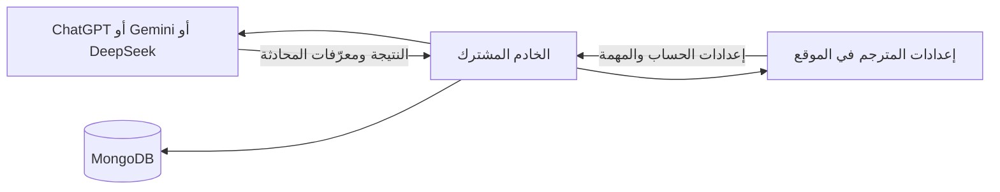

# دعم الحسابات في الموقع

## الاتصال بالخادم

الموقع والخادم متصلان بالفعل. هذا التعديل يحدّث واجهة الموقع لتعرض خيارات الحسابات التي أضيفت إلى الخادم سابقًا، ويمنع سقوط الحقول الجديدة عند الحفظ.

بقي عنوان API الافتراضي الأصلي `https://c-production-6948.up.railway.app` كما هو. يمكن تغييره عبر `VITE_API_URL` وفق إعداد النشر الموجود أصلًا. يلزم أن يتضمن الخادم مسارات `/api/translator/accounts/*` وحفظ حقول الحسابات، كما في [C commit 362a264](https://github.com/cobrapk8ggggggg-tech/C/commit/362a26425fab6ddea0d3157094008020c821a7f2) أو إصدار متوافق أحدث.

أعاد فحص طلب بلا مصادقة إلى مسار account models على الخادم المشترك HTTP 401؛ هذا يثبت وجود استجابة مصادقة، ولا يثبت وحده نجاح حساب مزوّد أو إصدار الخادم بالكامل. لم تُغيّر بيانات نشر الخادم أو Vercel من خلال هذا التعديل.

## الاستخدام

1. افتح لوحة التحكم بحسابك الإداري، ثم **إعدادات المترجم**.
2. أضف **ChatGPT Android** أو **Gemini Web** أو **DeepSeek 3MH / Telegram**.
3. ضع بيانات الحساب في حقل المفاتيح، كل حساب في سطر. لوحة جلب المشاريع وتجربة الحساب تستخدم أول رمز مُدخل.
4. افتح المهمة المطلوبة: الترجمة أو المصطلحات أو المراجعة أو العناوين أو البيانات.
5. اختر سلوك المحادثة، ثم احفظ الإعدادات.

| السلوك | معناه |
|---|---|
| محادثة مستقلة لكل مهمة تشغيل | ينشئ الخادم محادثة مستقلة حسب الحساب والمزوّد ونوع المهمة وjob؛ تستأنف من حالة MongoDB |
| محادثة جديدة لكل طلب | ينشئ محادثة جديدة لكل عملية توليد، مع إبقاء أجزاء الفصل الواحد معًا حسب منطق الخادم |
| استخدام المحادثة المختارة | يتابع المعرّف المحفوظ؛ لا يسمح الموقع بحفظ هذا الوضع دون معرّف |

### ChatGPT Android

يستخدم access token لحساب ChatGPT، وليس مفتاح OpenAI API. معرّف الحساب اختياري إذا كان ضمن ادعاءات الرمز. عند تدوير حسابات مختلفة، يُفضّل تركه فارغًا أو إنشاء مزوّد مستقل لكل حساب.

- «جلب المشاريع» يعرض مشاريع الحساب ومحادثاتها المتاحة، مع جلب المزيد عند توفر cursor.
- اختيار مشروع يعرض محادثاته ويمسح اختيار المحادثة السابقة لهذه المهمة؛ يمكن إدخال معرّف مشروع يدويًا أيضًا.
- يمكن اختيار محادثة من المشروع أو من المحادثات العامة، مع ترقيم صفحات الأخيرة.
- لإنشاء محادثة داخل مشروع: اختر المشروع، اكتب رسالة التجربة، ثم «إنشاء محادثة في المشروع». يملأ الرد معرّف المحادثة تلقائيًا. **احفظ الإعدادات** بعد ذلك.
- «جلب نماذج الحساب» يحدّث قائمة النماذج دون فقدان النموذج المحدد إذا ظل متاحًا. يمكن اختيار نموذج وتفكير مختلفين لكل مهمة.
- الصور والملفات ترفع عبر الخادم وتجهز للرسالة التالية في لوحة التجربة؛ 10 MB لكل ملف وعشرة مرفقات كحد أقصى. لا تضاف تلقائيًا إلى jobs ترجمة الفصول.

إعداد التفكير يمرر إلى الحقل الاختياري الذي يرسله الخادم. الملف المرفق الأصلي لا يثبت دعم هذا الخيار؛ قبول اسم المستوى وتطبيقه يحتاج تحققًا حيًا من الحساب والنموذج. عرض الحقل أو نجاح اختبار بنية الطلب ليس إثباتًا لتطبيق التفكير.

### Gemini Web

- كوكيز Google بصيغة `name=value; name=value`، مع رقم الحساب `/u/0` أو `/u/1` وفق الجلسة.
- إنشاء محادثة من لوحة التجربة يملأ conversation/response/choice IDs. يمكن إدخالها يدويًا لكل مهمة.
- Build label وترويسة JSPB اختيارية؛ تركهما فارغين يستخدم قيم عميل Gemini المرفق. تُفحص صحة JSON للترويسة قبل الحفظ.
- وضع الضيف مغلق افتراضيًا ويمكن تفعيله صراحة. الخادم لا ينتقل إليه مع محادثة مختارة أو مرفقات.
- لا تظهر أزرار جلب مشاريع أو محادثات Gemini أو التحكم بتفكيره، لأن بروتوكول المرفق لا يثبتها.

حجم جزء الترجمة (500–6000 حرف، الافتراضي 2400) يمرر إلى الخادم، حيث يعمل فحص تغطية الفقرات في المترجم الذكي والمترجم الخالص. الموقع لا ينفذ نسخة أخرى من فحص الاكتمال في المتصفح ولا يرسل فصول الترجمة مباشرة إلى Google.

### DeepSeek 3MH / Telegram

القالب الجديد يستخدم وكيل المحادثة الكامل على `https://deepseek-pow.contact-3mh.workers.dev`. يحتاج توكن حساب DeepSeek؛ الخدمة لا توفر حسابًا مجهولًا. يدعم رابط الخدمة والتفكير والبحث وtemperature وmax_tokens وpresence/frequency penalties والمحادثات لكل مهمة. تُحفظ القيم الصفرية دون استبدالها بالافتراضيات.

فصلت واجهته عن قالب DeepSeek Android: لا تظهر أزرار خبير/افتراضي أو POW التي لا تخص طلب الوكيل الكامل. رابط 3MH أضيف أيضًا لقائمة POW في القالب القديم لمن يريد استخدامه لحل الإثبات فقط. عند استخدام الخدمة يصل إليها توكن DeepSeek اللازم للطلب.

## سلوك الأخطاء والحفظ

- كل عمليات الحسابات تستعمل طبقة HTTP الحالية وتوكن تسجيل الدخول إلى الموقع. لا توجد اتصالات مباشرة من المتصفح إلى حسابات Google/OpenAI/DeepSeek.
- طلبات الإنشاء والإرسال والرفع لا تعاد تلقائيًا؛ قد يكون الخادم نفذ الرسالة قبل انقطاع الاتصال.
- مهلة التجربة والرفع تناسب العمليات الطويلة؛ يظهر تقدم الاتصال وتعطل عناصر المهمة والحفظ أثناء العملية.
- فشل الطلب لا يستبدل المحادثة المختارة ولا يحذف المرفقات المجهزة. بعد نجاح الإرسال تُمسح قائمة المرفقات.
- تغيير الرمز يمسح القوائم والمرفقات المؤقتة للحساب السابق؛ الرد المتأخر لا يطبق على رمز مختلف.
- يعرض الرد كنص React عادي، دون إدراج HTML خام. بيانات المزودين الجديدة لا تُكتب في localStorage أو sessionStorage أو IndexedDB؛ تظل بيانات الجلسة الأصلية للموقع وفق تصميمه السابق.
- إذا أعاد الخادم 404 لمسار حساب جديد تظهر رسالة تشير إلى ضرورة تحديث الخادم المتصل، بدل محاولة مسار مختلف صامتًا.
